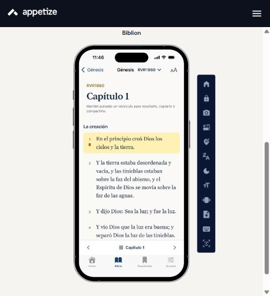
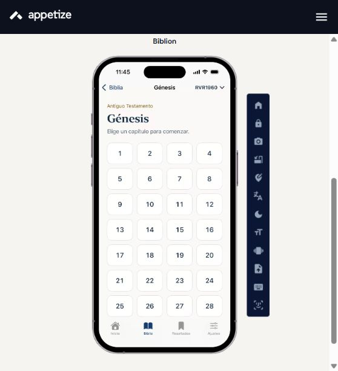

# Prueba en Appetize · 18 de octubre de 2026

## Resultado

**Ran:** Biblion 0.1.0 abrió y permitió leer la Biblia en Appetize, usando iPhone 14 Pro con iOS 26.0. No se utilizó cuenta, certificado ni perfil de aprovisionamiento de Apple.

URL verificada:

https://appetize.io/app/ios/com.cristiancogollo.biblion.ios?device=iphone14pro&osVersion=26.0&toolbar=true

Build de Appetize observado: `b_fp5dmnvjvscakflgulrkgf26la`. El acceso al enlace de la aplicación depende de la sesión/permisos de Appetize. No se modificaron sus permisos de acceso.

## Compilación y paquete

- `xtool dev build --triple arm64-apple-ios-simulator`: preparó el bundle.
- Enlace final con el motor nativo de SwiftPM, `--swift-sdk arm64-apple-ios-simulator -Xlinker -adhoc_codesign`.
- `Scripts/package_appetize.py`: verificó ARM64, plataforma iOS Simulator, firma local del ejecutable, Biblia idéntica al recurso del proyecto, permisos Unix e integridad del ZIP.
- Archivo final: `dist/Biblion-Appetize-arm64.zip`, 23,282,401 bytes.
- Metadatos `DTPlatformName=iphonesimulator` y `DTSDKName` derivados del SDK real registrado en Mach-O.
- Resultado local completo en `appetize-package.json`; el campo de ejecución de ese archivo corresponde solo a la verificación local, antes de la prueba en la nube.

El primer paquete no contenía `LC_CODE_SIGNATURE`. Appetize lo aceptó, pero no se consiguió ejecutar Biblion. Se investigó el enlace y se generó la firma ad hoc para el simulador. La opción de firma no se aplicaba mediante el motor SwiftBuild de esta instalación; el motor nativo sí generó la firma y el paquete resultante abrió correctamente.

El motor nativo de SwiftPM emite una advertencia de deprecación. El enlazador también emite advertencias sobre la plataforma Simulator. La ejecución real descrita aquí pasó; se debe revisar el flujo al actualizar Swift/xtool. No se modificó la compilación ni la firma para dispositivos físicos.

## Recorridos verificados visualmente

1. Inicio con ambos testamentos y acceso a lectura.
2. Abrir Génesis 1 y comprobar sus textos reales y títulos.
3. Mantener pulsado el primer versículo y abrir Resaltar/Copiar/Compartir.
4. Resaltar Génesis 1:1 y verificar fondo e indicador de resaltado.
5. Pasar a Génesis 2 mediante el control de capítulo siguiente.
6. Abrir Resaltados y comprobar Génesis 1:1 en la lista.
7. Abrir ese resaltado y volver al capítulo correspondiente.
8. Abrir Biblia, seleccionar Génesis, comprobar la cuadrícula de capítulos y abrir el capítulo 1.

## Capturas reales

## Pendiente

- iPhone físico con firma de desarrollo.
- Compatibilidad de ejecución en iOS 17/18: los intentos anteriores con el paquete sin firma no validan ni descartan esas versiones. También se observó un enlace fuerte a SwiftUICore, que requiere revisar la compatibilidad hacia atrás del SDK/enlazador.
- iPad, orientación horizontal, VoiceOver, Dynamic Type extremo, modos de tema y selector de versiones en ejecución.
- Persistencia entre arranques completos del proceso/dispositivo; el resaltado permaneció durante la navegación de la sesión comprobada.

Los registros de sesiones anteriores figuraban en el historial, pero sus enlaces de descarga no respondieron durante la investigación. No se presenta una causa de crash de esos registros como confirmada. La corrección se apoya en la inspección del ejecutable y en el arranque exitoso del paquete final.

## Actualización 0.2.0 (18 de octubre de 2026)

La versión ampliada está en el build `b_6fyhjqdb2hafkpa4iw5uklhgfm` (build number 5). Ver `PARITY-VALIDATION.md` para recorridos y capturas de esta actualización; el contenido anterior describe la primera versión 0.1.0.
